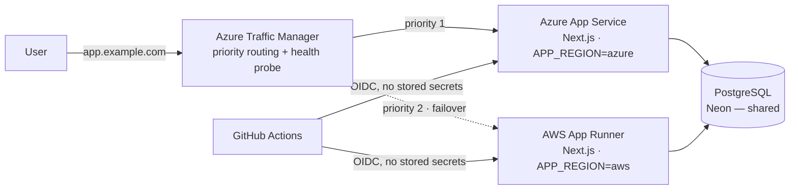

# Cloud Failover Demo — VEGAH Round 2 Technical Assessment

A small but complete full-stack application that proves multi-cloud delivery:
**Next.js + Node.js + PostgreSQL**, running on **Azure App Service (primary)** with an
**AWS (secondary)** deployment and **automated failover through a single hostname**,
shipped by **GitHub Actions**.

The page badge (`SERVED FROM: AZURE` / `AWS`) and `GET /api/health` make it obvious which
cloud answered the request, which is exactly the evidence the assessment asks for.

---

## 1. What the assessment asked for

| Requirement | Where it is implemented |
|---|---|
| Next.js (App Router) | `app/layout.tsx`, `app/page.tsx` |
| Node.js backend | Next.js server runtime + server actions (`app/actions.ts`) |
| PostgreSQL-backed feature | `lib/db.ts` — `messages` table (INSERT + SELECT) |
| Health endpoint | `GET /api/health` |
| Environment indicator | `APP_REGION` badge + `region` in health JSON |
| Azure primary (App Service) | `docs/RUNBOOK.md` §3 |
| AWS secondary (App Runner / EB / ECS) | `docs/RUNBOOK.md` §4 |
| Failover < 5 minutes, one hostname | Azure Traffic Manager priority routing — `docs/ARCHITECTURE.md` §4 |
| GitHub Actions CI/CD | `.github/workflows/ci.yml`, `.github/workflows/deploy.yml` |
| 5–10 min English walkthrough | `docs/PRESENTATION.md` |
| Setup & cleanup instructions | `docs/RUNBOOK.md` §7 |

---

## 2. Architecture



**Key decisions**

- **One shared PostgreSQL** (Neon free tier). Both clouds read/write the same data, so a
  write before failover is visible after failover. Trade-off documented in
  `docs/ARCHITECTURE.md` §5: the database is a single point of failure, which the
  assessment explicitly allows as long as it is documented.
- **Azure Traffic Manager** for failover: DNS-level, cloud-agnostic, health-probe driven,
  and it keeps a single hostname. Probe interval 10s, TTL 30s, so failover lands well
  under the 5-minute budget.
- **OIDC everywhere** — GitHub Actions assumes short-lived cloud roles; no long-lived
  cloud keys are stored in the repository.

---

## 3. Run locally

```bash
npm install
cp .env.example .env.local     # then edit DATABASE_URL
npm run dev                    # http://localhost:3000
```

Needs any PostgreSQL 14+. With Neon:

1. Create a project at neon.tech → copy the pooled connection string.
2. Paste it into `.env.local` as `DATABASE_URL`.
3. Start the app; the `messages` table is created automatically on first request.

Verify:

```bash
curl http://localhost:3000/api/health
```

```json
{ "status": "ok", "region": "local", "database": "up", "uptimeSeconds": 12 }
```

---

## 4. CI/CD

| Workflow | Trigger | Does |
|---|---|---|
| `ci.yml` | every push / PR | install → typecheck → build |
| `deploy.yml` | push to `main` (when `ENABLE_DEPLOY=true`) | deploy Azure job → deploy AWS job → smoke test `/api/health` |

Deployment is gated by the repository variable `ENABLE_DEPLOY`, so CI stays green while
cloud credentials are still being configured. Details in `docs/RUNBOOK.md` §5–6.

---

## 5. Failover evidence to capture

1. `GET https://app.example.com/api/health` → `"region": "azure"`.
2. Stop the Azure App Service.
3. Keep polling the same URL and timestamp each response.
4. Response flips to `"region": "aws"` — record elapsed time (target < 5 min).
5. Submit a message through the UI **after** failover → confirm the row is in PostgreSQL.
6. Save screenshots + a screen recording under `docs/evidence/`.

---

## 6. Repository layout

```
app/
  api/health/route.ts     health + region + DB probe
  actions.ts              server action (INSERT)
  page.tsx                form + latest messages (SELECT)
  layout.tsx
lib/db.ts                 pooled pg client, schema bootstrap
docs/
  ARCHITECTURE.md         design + trade-offs
  RUNBOOK.md              Azure / AWS / Traffic Manager / OIDC / cleanup
  TIME_LOG.md             actual hours, milestones, blockers
  PRESENTATION.md         5–10 min walkthrough script
.github/workflows/
  ci.yml
  deploy.yml
```

---

## 7. Known limitations (documented on purpose)

- Single shared PostgreSQL — no cross-region DB replication; a database outage affects both clouds.
- Azure App Service cold start after `Stop` is not instant; failover timing includes it.
- No authentication on the demo form (out of scope; noted in the presentation).
- AWS deployment is a container on App Runner, not ECS/Fargate; the assessment allows an equivalent service.

---

## 8. Assessment cost estimate

| Item | Approx. monthly |
|---|---|
| Azure App Service B1 (Linux) | ~$13 |
| Azure Traffic Manager | < $1 |
| AWS App Runner (0.25 vCPU / 0.5 GB, low traffic) | ~$5–8 |
| Neon Postgres free tier | $0 |
| **Total** | **~$20/month, ~$1–2 for a one-day assessment** |

Stop/delete everything after the assessment — `docs/RUNBOOK.md` §7.
